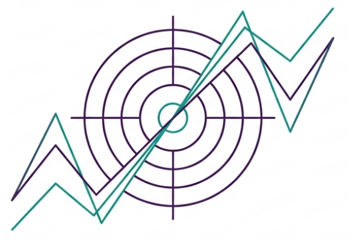
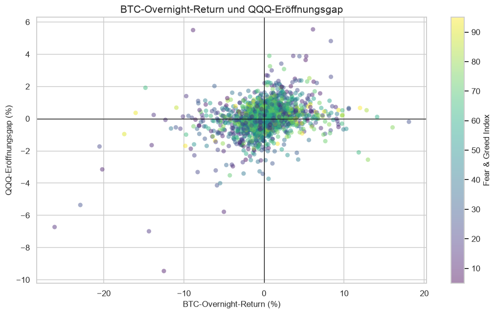
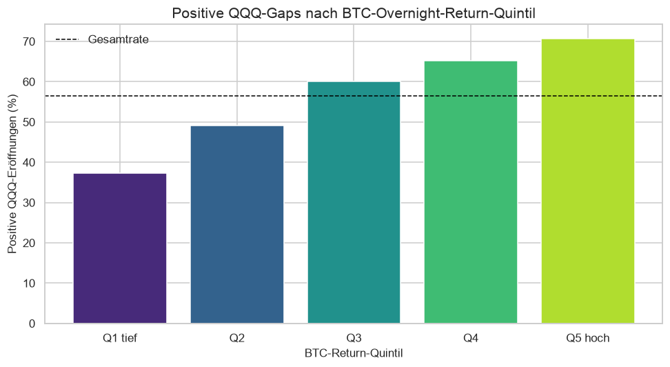
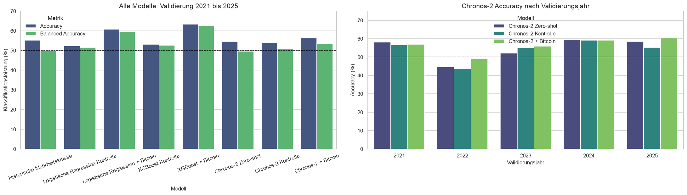
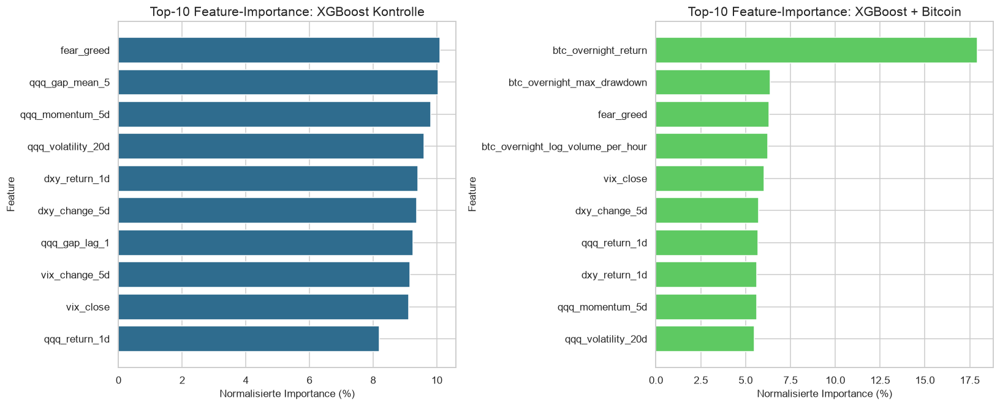
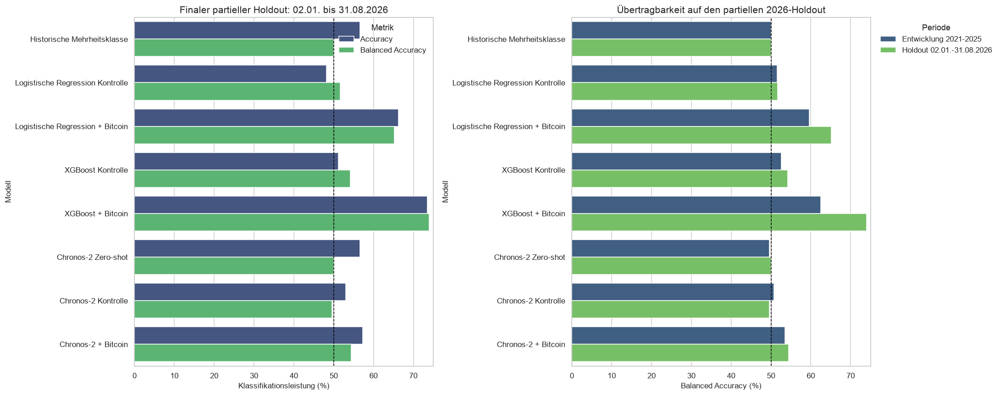
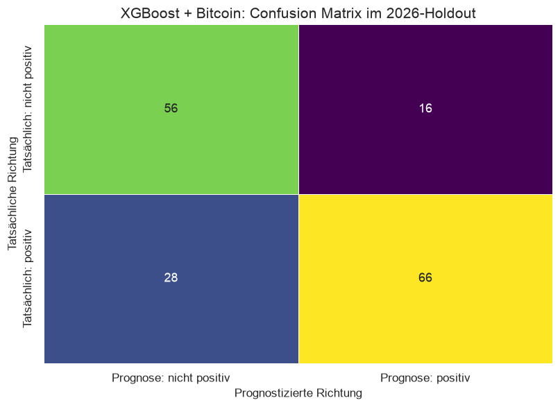

# Bitcoin als Frühindikator für den QQQ Eröffnungsgap

*Sandro Balz und Stefan Binkert · CSP1 Time Series Challenge · 2. Oktober 2026*

Die reguläre US-Börsensitzung ist vorbei. Die Bildschirme werden ruhiger, irgendwo wird der letzte Kaffee kalt. Bitcoin handelt weiter. Unsere Frage: Steckt in dieser nächtlichen Aktivität bereits ein Hinweis darauf, wie der Nasdaq-100-ETF QQQ am nächsten Handelstag eröffnet?

**Unser Ergebnis:** Im Testzeitraum vom 2. Januar bis 31. August 2026 prognostiziert XGBoost mit Bitcoin-Merkmalen die Richtung des QQQ-Eröffnungsgaps an **73,5 % der 166 Handelstage** richtig. Ohne diese Merkmale sind es bei derselben Modellklasse 51,2 %. Das ist ein interessanter Befund. Für die Bestellung einer Yacht reicht er noch nicht.

*Illustration aus unseren Präsentationsfolien, Predicting QQQ Gaps via Bitcoin, Seite 2. Die Linien sind schematisch und zeigen keine Messdaten.*

## Was wir vor der Eröffnung wissen wollen

Wir versuchen weder den nächsten Bitcoin-Kurs noch den gesamten Börsentag vorherzusagen. Die Aufgabe ist enger: **Eröffnet QQQ um 09:30 Uhr New Yorker Zeit höher als beim Schluss der vorherigen regulären Sitzung?** Eine gleich hohe oder tiefere Eröffnung zählt zur anderen Klasse.

Die Lücke zwischen diesen beiden Kursen heisst Eröffnungsgap. Im Notebook berechnen wir sie als logarithmische Rendite: `log(aktueller QQQ Open / vorheriger QQQ Close)`. Für die Klassifikation interessiert uns ihr Vorzeichen. Anschaulich: Schliesst QQQ bei 500 und eröffnet bei 505, ist der Gap positiv. Bei einem Open von 495 ist er negativ. Diese Kurse sind nur ein Rechenbeispiel.

Bitcoin könnte dabei als frühes Stimmungsbarometer dienen. Eine mögliche Erklärung ist, dass Kryptomärkte während der geschlossenen US-Kassamärkte neue Nachrichten und globale Risikostimmung aufnehmen. Ob Bitcoin tatsächlich Information überträgt oder beide Märkte auf dieselben Nachrichten reagieren, kann unser Experiment allerdings nicht unterscheiden.

Um den zusätzlichen Nutzen zu messen, vergleichen wir jeweils **dasselbe Modell ohne und mit Bitcoin**. Ein guter Wert allein wäre zu wenig: Vielleicht liefern bereits die QQQ-Historie oder andere Marktindikatoren die entscheidende Information.

## Die wichtigste Modellkomponente ist die Uhr

Um **09:00 Uhr New Yorker Zeit** machen wir den Informationsdeckel zu. Erst um 09:30 Uhr entsteht der Zielwert. Die letzte halbe Stunde bleibt vollständig ausserhalb unserer Merkmale. Ein Prognosemodell mit einem heimlichen Blick auf den Eröffnungskurs wäre beeindruckend treffsicher und ungefähr so nützlich wie eine Wettervorhersage von gestern.

Das Bitcoin-Fenster beginnt beim tatsächlichen Schluss der vorherigen Nasdaq-Sitzung. An einem normalen Handelstag umfasst es 17 Stunden; vor einem Montag typischerweise 65 Stunden. Feiertage und verkürzte Sitzungen erzeugen weitere Varianten, im Datensatz bis zu 92 Stunden. Deshalb verwenden wir einen Börsenkalender und die Zeitzone `America/New_York`, statt überall pauschal einen Tag abzuziehen.

In jedes Fenster dürfen nur vollständig abgeschlossene Bitcoin-Stundenkerzen gelangen. Fehlen Stunden, verwerfen wir das Fenster. Wir füllen es nicht mit erfundenen Kursen auf. QQQ, VIX und DXY stammen aus der vorherigen abgeschlossenen Sitzung; bei Fear & Greed verwenden wir den letzten Wert mit einem Zeitstempel vor oder genau am Cutoff.

| Daten | Quelle | Rolle im Experiment |
|---|---|---|
| Stündliche Bitcoin-Kurse und Volumen | Binance Public Data | Nächtliche Aktivität |
| QQQ | Yahoo Finance über yfinance | Zielwert und eigene Kurshistorie |
| VIX und US-Dollar-Index DXY | Yahoo Finance über yfinance | Volatilitäts- und Makroumfeld |
| Fear & Greed | Alternative.me | Krypto-Sentiment |
| Nasdaq-Sitzungen | exchange_calendars | Feiertage, Sitzungsschlüsse und Fensterlängen |

Nach der Bereinigung bleiben **2’111 Tagesbeobachtungen**: 1’945 für Entwicklung und Validierung sowie 166 für den späteren Holdout. 44 Zeilen fallen wegen unvollständiger Bitcoin-Fenster oder noch nicht verfügbarer gleitender Merkmale weg. Der fertige Datensatz beginnt am 5. März 2018.

## Wie aus einer Bitcoin Nacht fünf Merkmale werden

Ein Modell kann mit «Bitcoin war heute irgendwie nervös» wenig anfangen. Wir übersetzen die Nacht deshalb in fünf messbare Eigenschaften.

| Bitcoin-Merkmal | Die Frage dahinter |
|---|---|
| Overnight-Return | Ist Bitcoin über das gesamte Fenster gestiegen oder gefallen? |
| Volatilitätsintensität | Wie stark waren die stündlichen Bewegungen? |
| Handelsspanne | Wie weit lagen das höchste Hoch und das tiefste Tief auseinander? |
| Logarithmierte Volumenintensität | Wie viel wurde durchschnittlich pro Stunde gehandelt? |
| Maximaler Drawdown | Wie stark fiel der Kurs innerhalb des Fensters von einem zwischenzeitlichen Hoch? |

Die Normierung ist entscheidend: Ein Wochenende hat schon wegen seiner Länge mehr Gelegenheit, Handelsvolumen anzusammeln. Ein Vergleich des reinen Gesamtvolumens würde leicht einen Kalendereffekt als Marktsignal verkleiden. Deshalb messen wir Volumen pro Stunde und die Volatilität als Wurzel des mittleren quadrierten Stundenreturns. Return, Handelsspanne und Drawdown beschreiben dagegen das gesamte Fenster.

Unser Kontrollset enthält zwölf Merkmale aus QQQ-Historie, VIX, DXY, Fear & Greed und Kalender. Das Bitcoin-Set ergänzt genau diese fünf Variablen und kommt damit auf 17 Merkmale. Beide Sets stehen vor dem Modellvergleich fest. Wir lassen also nicht nachträglich nur jene Zutaten im Rezept, die zufällig den besten Kuchen ergeben haben.

## Die ersten Charts machen neugierig

Die explorative Analyse bleibt auf Daten vor 2026 beschränkt. Sie zeigt einen positiven, aber keineswegs perfekten Zusammenhang zwischen Bitcoin-Overnight-Return und QQQ-Gap. Die lineare Korrelation beträgt **0,316**. Der Scatterplot erinnert entsprechend eher an eine lebhafte Punktwolke als an eine ordentlich aufgereihte Zugverbindung.

*Abbildung 1 · Entwicklungsdaten vor 2026. Originalgrafik aus Notebook-Abschnitt 7.2. Eine Korrelation beschreibt einen Zusammenhang, noch keine Leistung auf späteren Daten.*

Noch anschaulicher wird es, wenn wir die Bitcoin-Returns in fünf gleich grosse Gruppen teilen. In der Gruppe mit den tiefsten Returns eröffnet QQQ in **37,3 %** der Fälle positiv; in der Gruppe mit den höchsten Returns sind es **70,7 %**. Der Anteil steigt über die fünf Gruppen geordnet an.

*Abbildung 2 · Je 389 Entwicklungsbeobachtungen pro Quintil. Originalgrafik aus Notebook-Abschnitt 7.3. Die Gruppengrenzen dienen der Beschreibung und werden nicht als optimierte Handelsschwellen verwendet.*

Das sieht vielversprechend aus. Es ist aber weiterhin ein Blick auf bekannte Entwicklungsdaten. Die eigentliche Prüfung lautet: Hilft die Information auch bei einer Prognose, deren Ergebnis das Modell noch nicht kennt?

## Vier Ansätze treten zum Vergleich an

**Die historische Mehrheitsklasse** ist unser minimaler Gegner. Vor jedem Tag schaut sie, welche Gap-Richtung in der bisherigen Historie häufiger war. Im Validierungszeitraum sagt sie dadurch immer «positiv» und erreicht 55,1 % Accuracy. Ein Modell kann also öfter richtig als falsch liegen, ohne einen einzigen negativen Gap zu erkennen. Der Optimist im Raum hat bereits einen respektablen Lebenslauf.

Darum berichten wir zusätzlich die **Balanced Accuracy**: den Mittelwert der Trefferquote für positive und nicht positive Gaps. Beide Klassen erhalten dasselbe Gewicht. Die Mehrheitsbaseline landet hier bei 50,0 %. Erst diese zweite Perspektive zeigt, ob ein Modell beide Richtungen unterscheiden kann.

**Die logistische Regression** schätzt die Wahrscheinlichkeit eines positiven Gaps mit einer linearen Entscheidungsfunktion. Sie ist unser verständlicher, leichtgewichtiger Vergleich. Die Merkmale werden vor jeder Prognose ausschliesslich anhand der damaligen Trainingshistorie standardisiert.

**XGBoost** kombiniert kleine Entscheidungsbäume und kann nichtlineare Beziehungen sowie das Zusammenspiel mehrerer Merkmale abbilden. Wir verwenden 150 bewusst flache Bäume mit Tiefe 2 und feste, konservative Einstellungen.

**Chronos-2** bringt vortrainiertes Wissen über Zeitreihen mit. Es unterstützt Prognosen mit zusätzlichen Begleitvariablen, wie im [offiziellen Repository](https://github.com/amazon-science/chronos-forecasting) beschrieben. Wir nutzen es ohne Fine-Tuning in drei Varianten: nur mit vergangenen QQQ-Gaps, mit den Kontrollmerkmalen und mit Kontrolle plus Bitcoin. Es prognostiziert den numerischen Gap; das Vorzeichen seiner Medianprognose liefert die Richtung.

Das Experiment läuft chronologisch. Zuerst stehen Daten von 2018 bis 2020 zur Verfügung, dann prognostizieren wir 2021. Für 2022 ist die bis dahin bekannte Historie länger, und so weiter bis 2025. Innerhalb jedes Jahres werden logistische Regression und XGBoost vor jedem Prognosetag neu trainiert; der gerade erst beobachtete Tag darf danach zur Vergangenheit des nächsten Tages werden. Dieses Vorgehen entspricht dem Prinzip der [Zeitreihenvalidierung mit fortlaufendem Prognoseursprung](https://otexts.com/fpp3/tscv.html).

So entstehen **1’248 Prognosetermine von 2021 bis 2025**. Alle Modelle werden an denselben Tagen beurteilt. Die Jahre werden nicht zufällig durchmischt. Features, Parameter und Entscheidungsregeln bleiben fest; eine Hyperparametersuche ist nicht Teil dieses Experiments.

## Was die Validierung über Bitcoin zeigt

In der Validierung erreicht XGBoost mit Bitcoin **63,3 % Accuracy und 62,5 % Balanced Accuracy**. Ohne Bitcoin liegt seine Balanced Accuracy bei 52,6 %. Der Zusatz beträgt damit 9,9 Prozentpunkte. Bei der Accuracy gewinnt die Bitcoin-Variante in allen fünf Validierungsjahren gegen ihre Kontrollvariante.

Auch die logistische Regression profitiert: Mit Bitcoin steigt ihre Balanced Accuracy von 51,5 % auf 59,6 %. Das Signal hängt in unserem Vergleich also nicht allein an einer besonders flexiblen Modellklasse.

*Abbildung 3 · Validierung 2021 bis 2025 auf 1’248 gemeinsamen Prognoseterminen. Originalgrafik aus Notebook-Abschnitt 11.2. Die rechte Hälfte zeigt Accuracy, nicht Balanced Accuracy.*

Die Feature-Importance des auf allen Entwicklungsdaten geschätzten XGBoost-Modells passt dazu: Der Bitcoin-Overnight-Return erhält im Modell mit Bitcoin das höchste Gewicht. Zusammen entfallen **40,9 % der normalisierten Importance** auf die fünf Bitcoin-Merkmale.

*Abbildung 4 · Deskriptive Modelle auf den Entwicklungsdaten bis Ende 2025. Originalgrafik aus Notebook-Abschnitt 10.2. Importance zeigt die Nutzung eines Merkmals im Modell; sie erklärt weder Wirkungsrichtung noch Kausalität.*

Chronos-2 erreicht mit Bitcoin 53,5 % Balanced Accuracy und bleibt hinter den beiden trainierten Bitcoin-Modellen zurück. Die zusätzliche Information hilft auch hier, aber weniger stark. Die grosse Modellfamilie bringt also keine automatische Garantie für die beste Lösung einer kleinen, spezialisierten Finanzaufgabe mit.

Eine weitere Erfahrung betrifft Unsicherheit: Das nominelle 80-%-Prognoseintervall von Chronos-2 mit Bitcoin enthält in der Validierung nur **40,1 %** der tatsächlichen Gaps. Ein schön gezeichnetes Unsicherheitsband muss sich seine Glaubwürdigkeit ebenfalls verdienen.

Auf Grundlage dieser Validierung legen wir **XGBoost mit Bitcoin als Hauptmodell fest, bevor wir den Holdout auswerten**.

## Der Holdout von Januar bis August 2026

Bis hierhin war 2026 für die Entwicklung verschlossen. Nun prüfen wir die festgelegte Methode auf den **166 Handelstagen vom 2. Januar bis 31. August 2026**. Es handelt sich um acht Monate, nicht um ein vollständiges Kalenderjahr.

*Illustration aus unseren Präsentationsfolien, Predicting QQQ Gaps via Bitcoin, Seite 12. Der Tresor steht für die Trennung von Modellentwicklung und abschliessender Auswertung.*

Die Methodik bleibt eingefroren. Das Training wächst trotzdem täglich um inzwischen bekannte Beobachtungen: am ersten Holdout-Tag stehen 1’945 frühere Tage zur Verfügung, am letzten 2’110. «Holdout» bedeutet hier also eine sequenzielle Prüfung einer vorher festgelegten Methode. Es bedeutet nicht, dass ein einziges, im Dezember trainiertes Modell acht Monate unverändert weiterläuft.

| Modell | Validierung 2021 bis 2025 Balanced Accuracy | Holdout Accuracy | Holdout Balanced Accuracy |
|---|---:|---:|---:|
| Historische Mehrheitsklasse | 50,0 % | 56,6 % | 50,0 % |
| Logistische Regression Kontrolle | 51,5 % | 48,2 % | 51,7 % |
| Logistische Regression + Bitcoin | 59,6 % | 66,3 % | 65,2 % |
| XGBoost Kontrolle | 52,6 % | 51,2 % | 54,2 % |
| **XGBoost + Bitcoin** | **62,5 %** | **73,5 %** | **74,0 %** |
| Chronos-2 nur Gap-Historie | 49,6 % | 56,6 % | 50,0 % |
| Chronos-2 Kontrolle | 50,7 % | 53,0 % | 49,6 % |
| Chronos-2 + Bitcoin | 53,5 % | 57,2 % | 54,4 % |

Alle Holdout-Werte beziehen sich auf dieselben 166 Tage; die Validierungswerte auf dieselben 1’248 Prognosetermine. Zahlen aus den ausgeführten Ergebnistabellen, auf eine Dezimalstelle gerundet. «Kontrolle» bezeichnet das Set ohne Bitcoin; die reine Gap-Historie entspricht der im Notebook als «Chronos-2 Zero-shot» bezeichneten univariaten Referenz. Auch die beiden anderen Chronos-Varianten werden ohne Fine-Tuning eingesetzt.

*Abbildung 5 · Originalgrafik aus Notebook-Abschnitt 12.3. Links stehen die Holdout-Metriken, rechts die Balanced Accuracy der beiden Zeiträume.*

Der zentrale Vergleich fällt deutlich aus: **74,0 % statt 54,2 % Balanced Accuracy innerhalb von XGBoost**, ein Bitcoin-Zusatz von **19,8 Prozentpunkten**. Die Bitcoin-Variante ist in sieben von acht Monaten besser als ihre Kontrolle. Im Januar gilt das Gegenteil. Da jeder Monat nur 19 bis 22 Beobachtungen umfasst, verstehen wir das als einfache Stabilitätskontrolle.

Die Confusion Matrix übersetzt die Prozentwerte in konkrete Fälle: 56 nicht positive und 66 positive Gaps werden richtig erkannt. Hinzu kommen **16 falsch positive und 28 falsch negative Prognosen**. Insgesamt sind das **122 richtige und 44 falsche Entscheidungen**. Diese 44 Fehlprognosen gehören genauso zur Geschichte wie die 73,5 %.

*Abbildung 6 · Originalgrafik aus Notebook-Abschnitt 12.3. Zeilen zeigen die tatsächliche Richtung, Spalten die Prognose. «Nicht positiv» umfasst gleiche und tiefere Eröffnungen.*

Chronos-2 mit Bitcoin erreicht im Holdout 54,4 % Balanced Accuracy. Sein nominelles 80-%-Intervall deckt nur noch 31,3 % der tatsächlichen Gaps ab. In dieser Anwendung können wir es deshalb nicht als verlässliches Risikoband behandeln.

## Was wir aus dem Projekt mitnehmen

**Saubere Zeitgrenzen sind Teil des Modells.** Unsere Merkmale mussten nicht nur plausibel aussehen, sondern zum Prognosezeitpunkt verfügbar sein. Zeitzonen, Sommerzeit, verkürzte Sitzungen und abgeschlossene Stundenkerzen entscheiden mit darüber, ob der Vergleich überhaupt sinnvoll ist.

**Datenarbeit schlägt glamouröse Modellnamen.** Schon beim Einlesen mussten wir unterschiedliche Bitcoin-Zeitstempel in Milli- und Mikrosekunden korrekt erkennen. Fehlende Stunden und unterschiedliche Fensterlängen verlangten klare Regeln. Diese Arbeit liefert selten die spektakulärste Folie, aber sie trägt das gesamte Experiment.

**Eine einfache Baseline schützt vor Selbsttäuschung.** «Immer positiv» erreicht im Holdout bereits 56,6 % Accuracy. Deshalb braucht es den Vergleich mit der Kontrolle und die Balanced Accuracy. Ohne sie könnten wir einen höflichen Daueroptimisten für ein lernfähiges Prognosemodell halten.

**Ein Foundation Model braucht einen Praxistest.** Chronos-2 kann die zusätzlichen Merkmale verarbeiten, doch die trainierten Modelle passen in unserem Setup besser zur Richtungsaufgabe. Die Unsicherheitsintervalle zeigen ausserdem, dass Prognosegüte und verlässliche Unsicherheit zwei getrennte Prüfungen verlangen.

**Auch falsche Entscheidungen haben eine Stärke.** Im Notebook betrachten wir ergänzend den Abstand zur Entscheidungsgrenze. Eine knappe Fehlentscheidung ist anders als eine sehr deutliche. Die entsprechenden Scores haben bei Klassifikatoren und Chronos-2 allerdings unterschiedliche Einheiten; ihre Rohwerte dürfen wir nicht zu einer gemeinsamen Rangliste zusammenwerfen.

**Ein guter Testzeitraum bleibt ein Testzeitraum.** Acht Monate mit 166 Tagen und nur 32 Montagen sind begrenzt. Dass XGBoost im Holdout besser abschneidet als in der Validierung, erlaubt keine Zusage für die nächste Marktphase. Unsere festen Einstellungen wurden zudem nicht auf optimale Leistung abgestimmt.

## Was das Ergebnis bedeutet und was offen bleibt

Unsere Ausgangsfrage beantworten wir für den untersuchten Zeitraum positiv: **Bitcoin-Overnight-Merkmale liefern in diesem Vergleich zusätzliche Information für die Richtung des QQQ-Eröffnungsgaps.** XGBoost nutzt sie am erfolgreichsten; auch die logistische Regression gewinnt gegenüber ihrer Kontrolle.

Eine profitable Handelsstrategie haben wir damit nicht nachgewiesen. Die Vorhersage um 09:00 Uhr und der Gap um 09:30 Uhr lassen sich nicht automatisch in einen erzielbaren Gewinn übersetzen. Dafür müsste eine gesonderte Untersuchung handelbare Instrumente, einen Einstieg vor der Eröffnung, Liquidität und Transaktionskosten berücksichtigen. Zudem unterscheidet die Richtungsmetrik nicht zwischen kleinen und grossen Gaps.

Als nächste Forschungsfragen bieten sich ein längerer späterer Testzeitraum, weitere Marktphasen und der Vergleich mit anderen vorbörslichen Informationsquellen an. Eine mögliche Parameteroptimierung müsste in einer zusätzlichen zeitlichen Validierung innerhalb der Trainingsdaten stattfinden. Der bereits ausgewertete Holdout steht dafür nicht mehr als unangetasteter Test zur Verfügung.

Bitcoin übernimmt in unserem Projekt also die Nachtschicht. Die entscheidende Arbeit leisten aber die sorgfältige Datenaufbereitung und ein Vergleich, der die Zukunft erst dann sieht, wenn sie tatsächlich Vergangenheit geworden ist. Die Yacht bleibt vorerst ein Rechenbeispiel.

## Notebook und Quellen

Die Berechnungen, Prüfungen und vollständigen Resultate stehen im ausgeführten Projekt-Notebook. Alle sechs Ergebnisgrafiken dieses Beitrags sind unveränderte PNG-Ausgaben dieses Notebooks. Die beiden schematischen Illustrationen stammen aus unseren Präsentationsfolien im Ordner `slides`; ihre Herkunft ist bei der jeweiligen Abbildung angegeben.

Die Daten stammen aus [Binance Public Data](https://data.binance.vision/), [Yahoo Finance über yfinance](https://ranaroussi.github.io/yfinance/) und der [Fear & Greed API von Alternative.me](https://alternative.me/crypto/fear-and-greed-index/). Für die Börsensitzungen verwenden wir [exchange_calendars](https://github.com/gerrymanoim/exchange_calendars).

Methodische Hintergründe liefern Hyndman und Athanasopoulos in [Forecasting Principles and Practice zur Zeitreihenvalidierung](https://otexts.com/fpp3/tscv.html), Chen und Guestrin im [XGBoost-Paper](https://doi.org/10.1145/2939672.2939785) sowie Ansari und Mitautoren im [Chronos-2 Technical Report](https://arxiv.org/abs/2510.15821). Die Umsetzung von Chronos ist im [offiziellen Repository](https://github.com/amazon-science/chronos-forecasting) dokumentiert.

*Datenstand: bis 31. August 2026. Ausbildungs- und Forschungsprojekt an der FHNW im Modul CSP1.*
